<div align="center">

<picture>
  <source media="(prefers-color-scheme: dark)" srcset="docs/readme/banner-dark.svg">
  
</picture>

<p>
  <a href="https://apps.apple.com/it/app/lineami/id6835143643?l=en-GB"><b>Download on the App Store</b></a> ·
  <a href="https://gabrielevierti.github.io/linea-support/"><b>Website</b></a> ·
  <a href="https://gabrielevierti.github.io/linea-support/privacy.html"><b>Privacy</b></a> ·
  <a href="#support"><b>Support</b></a>
</p>

</div>

This repository is the website of **LineaMI**: the product page, the FAQ and support contact, and the privacy policy, published with GitHub Pages in Italian and English.

**LineaMI** puts Milan's metro, trams, buses and Trenord trains in one app for iPhone and Apple Watch: what's coming near you, when to leave and how to get there, step by step. The official timetables live on the phone, so it works underground with no signal. Free, with no account, no ads and no tracking. *Muoviti meglio.*

<picture>
  <source media="(prefers-color-scheme: dark)" srcset="docs/readme/features-dark.svg">
  
</picture>

**And also:** a "When to leave" widget and a last-ride warning, step-free routes, a metro map, full timetables and saved routes, Siri and Shortcuts, an airport guide and six languages.

> [!NOTE]
> **Timetables are scheduled, not real time.** LineaMI uses the timetables published by the City of Milan (ATM) and Lombardy Region (Trenord). During a trip it follows your position with GPS and, if the vehicle is late, shifts the next steps.

## Support

Write about problems, ideas or a timetable that looks wrong. I answer personally, usually within a couple of days.

- **Email:** [gabriele.vierti@gmail.com](mailto:gabriele.vierti@gmail.com?subject=LineaMI)

## About this repository

A static site with no build step:

| File | What it is |
| --- | --- |
| `index.html` | Product page, features, FAQ and support (Italian by default, English included) |
| `privacy.html` | Privacy policy |
| `style.css` | Styles |
| `app.js` | Italian / English switch, remembered in the browser |
| `icon.png`, `favicon.png`, `apple-touch-icon.png`, `og-image.jpg` | Icons and the social preview image |

Preview it locally with any static server:

```sh
python3 -m http.server 8000    # then open http://localhost:8000
```

Pushing to the default branch updates the live site through GitHub Pages.

## Data and credits

LineaMI is an independent app and is not affiliated with ATM, Trenord, BikeMi or the City of Milan.

- **Timetables:** City of Milan and Trenord (Lombardy Region Open Data), licensed under [CC BY 4.0](https://creativecommons.org/licenses/by/4.0/).
- **Bikes:** BikeMi open data, licensed under [NLOD 2.0](https://data.norge.no/nlod/en/2.0).
- **Strikes:** Italian Ministry of Infrastructure and Transport.

---

<sub>© 2026 <a href="https://github.com/gabrielevierti">Gabriele Vierti</a>, Milan.</sub>
